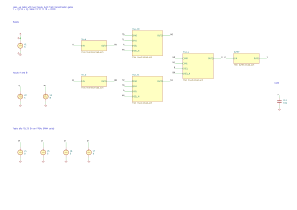
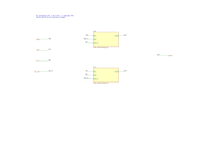
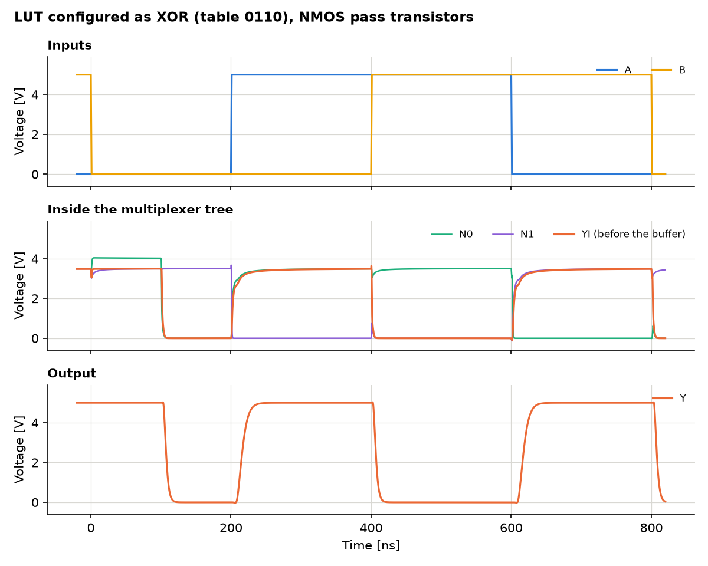

# A look-up table built from transistors

A LUT with two inputs, the logic element of an FPGA, built from 20 MOS
transistors. The circuit is described in Python with
[SKiDL](https://devbisme.github.io/skidl/), drawn as a KiCad schematic,
simulated with ngspice, and the result is written as a VCD file that opens
in [GTKWave](https://gtkwave.sourceforge.net/).

```
SKiDL (lut.py)  ->  KiCad schematic  ->  ngspice  ->  VCD  ->  GTKWave
```

## What a LUT is

A LUT with k inputs does not compute anything. It stores the truth table of
a logic function in 2^k memory bits, and its inputs select which of these
bits appears at the output. With two inputs there are four bits and
therefore 16 possible functions, from AND to XOR, all realised by the same
hardware. Only the stored bits differ. That is what makes an FPGA
programmable.

```
T0 --[A=0]--+
            +-- N0 --[B=0]--+
T1 --[A=1]--+               +-- YI --|>o--|>o-- Y
T2 --[A=0]--+               |
            +-- N1 --[B=1]--+
T3 --[A=1]--+
```

The selection is a tree of 2:1 multiplexers, one level per input. The table
index is `2 B + A`. A buffer of two inverters restores the level and drives
the load. The four table bits T0 to T3 are voltage sources here; in an FPGA
they are SRAM cells written by the bitstream.

## Two variants

The switches of the multiplexers can be built in two ways, and the
repository contains both.

| Variant | Switch | Transistors | Schematic |
|---|---|---|---|
| `tgate` | transmission gate, NMOS and PMOS in parallel | 20 | `tgate/lut2.kicad_sch` |
| `pass` | a single NMOS pass transistor | 14 | `pass/lut2.kicad_sch` |

## A hierarchical schematic

The schematic is hierarchical. Every building block is drawn once, on a
sheet of its own, and used as often as needed.

| Sheet | File | Content | Used |
|---|---|---|---|
| `lut2` | `lut2.kicad_sch` | sources, load, and the sheets below | 1 |
| `inverter` | `inverter.kicad_sch` | one PMOS, one NMOS | 4 |
| `mux2` | `mux2.kicad_sch` | two switches | 3 |
| `switch` | `switch.kicad_sch` | one or two transistors | 6 |
| `buffer` | `buffer.kicad_sch` | two inverters | 1 |

Five files describe 15 sheets. The hierarchy is three levels deep: the
transistors of a switch sit in `lut2 / mux_n0 / sw0`.



The root sheet shows the structure of the LUT: two inverters for the
complements of the inputs, two multiplexers selected by A, one selected by
B, and the buffer.




In KiCad a sheet that is used several times stores the references of its
symbols once per use. The transistors of `switch.kicad_sch` are Q5 and Q6
in `mux_n0 / sw0` and Q15 and Q16 in `mux_y / sw1`. `hier.py` takes care
of this: it walks the hierarchy, creates the flat SKiDL circuit and writes
every sheet with the references of all its uses.

## Results

Both variants compute all 16 functions correctly: 64 of 64 table entries.
All numbers below are written by `simulate.py` to `results/summary.md`.

| Quantity | Transmission gates | Pass transistors |
|---|---|---|
| Level of the internal node YI for a 1 | 5.00 V | 3.48 V |
| Level of the output Y for a 1 | 5.00 V | 5.00 V |
| Supply current at rest, largest | 0.015 µA | 84 µA |
| Delay A to Y, rising / falling | 12.2 ns / 9.1 ns | 16.2 ns / 7.3 ns |
| Delay B to Y, rising / falling | 10.8 ns / 7.8 ns | 15.2 ns / 6.7 ns |
| Delay table bit to Y, rising / falling | 11.1 ns / 8.2 ns | 14.7 ns / 6.8 ns |

What the numbers show:

- **A pass transistor loses a threshold voltage.** An NMOS can pull a node
  up only to its gate voltage minus its threshold, and the threshold grows
  with the source voltage (body effect). The internal node reaches 3.48 V
  instead of 5 V.
- **The buffer restores the level, at a price.** With 3.48 V at its input
  the first inverter is not fully switched. Both of its transistors conduct
  and the circuit draws 84 µA at rest, more than five thousand times the
  current of the transmission-gate variant. Real FPGAs use pass transistors
  anyway, because they are small, and add a weak pull-up that restores the
  level.
- **The input of the last level is the fastest.** A signal at B passes one
  multiplexer, a signal at A passes two. B is faster by about 1.4 ns.
  Synthesis tools use this and route timing-critical signals to the fast
  inputs of a LUT.
- **Rising edges are slower in the pass variant**, because the pass
  transistor turns off as the node approaches its final level.



The plot shows one function window of 800 ns. During the first 100 ns the
table still holds the previous function; it is rewritten at 100 ns.

### Glitches

If both inputs change at the same instant, the multiplexer tree passes
through an intermediate state, even if the old and the new table entry are
the same. `simulate.py` tests this in a second run.

| Variant | Lowest level of YI | Lowest level of Y |
|---|---|---|
| transmission gates | 3.14 V | 5.00 V |
| pass transistors | 1.68 V | 4.95 V |

The internal node dips, in the pass variant below half the supply, but the
dip is too short for the buffer to follow. With these transistors and this
load no glitch reaches the output. That is a property of this circuit, not
of LUTs in general.

## Viewing the waveforms in GTKWave

```sh
gtkwave results/lut2_tgate.vcd results/lut2_tgate.gtkw
gtkwave results/lut2_pass.vcd results/lut2_pass.gtkw
gtkwave results/lut2_pass_glitch.vcd results/lut2_pass_glitch.gtkw
```

The `.gtkw` file sets up the view: the table as a hexadecimal number, the
inputs, the selected index and the output as logic signals, and below them
the node voltages as analog traces.

| Signal | Kind | Content |
|---|---|---|
| `table[3:0]` | bit vector | the stored function, T3 T2 T1 T0 |
| `a`, `b`, `y` | bit | logic value, threshold at half the supply |
| `index[1:0]` | bit vector | `2 B + A`, the selected table entry |
| `v_a`, `v_b` | real | input voltages |
| `v_n0`, `v_n1` | real | outputs of the first multiplexer level |
| `v_yi` | real | output of the tree, before the buffer |
| `v_yb`, `v_y` | real | after the first and the second inverter |

VCD is a format for digital signals, but it also knows real numbers, and
GTKWave draws them as curves (Data Format, Analog). `vcd.py` is a writer of
about 100 lines without dependencies.

## The simulation

One transient run of 12.8 µs per variant covers all 16 functions.

- The inputs step through the four combinations in Gray code, index
  0, 1, 3, 2, in steps of 200 ns. Only one input changes at a time, so
  every edge of the output can be attributed to one input.
- Every 800 ns the table bits are rewritten, 100 ns after the inputs have
  returned to 00. This is the simulation's version of loading a new
  bitstream.
- The output is sampled 5 ns before the end of every step and compared with
  the table.

The netlist that is simulated is exported from the KiCad schematic with
`kicad-cli`, which flattens the hierarchy, so the schematic is what gets
simulated.

## Files

| File | Content |
|---|---|
| `lut.py` | the design: sheets `inverter`, `switch`, `mux2`, `buffer` and the root `lut2` |
| `hier.py` | hierarchy: elaborates the sheets into a flat SKiDL circuit and writes the KiCad sheets |
| `generate.py` | writes netlists and schematics, verifies the schematic against the SKiDL circuit |
| `simulate.py` | simulation, analysis, VCD and GTKWave files, plots |
| `vcd.py` | VCD writer |
| `kicad_sch.py`, `ngspice.py` | schematic writer and ngspice wrapper, from [naive-diff-amp-comperator](https://github.com/MaxClerkwell/naive-diff-amp-comperator) |
| `tgate/`, `pass/` | generated KiCad projects: root sheet `lut2.kicad_sch`, four sub-sheets, netlist `lut2.net` |
| `docs/` | renderings: one SVG per sheet, one PDF per variant |
| `results/` | VCD and GTKWave files, plots, netlists, `summary.md` |

## Usage

```sh
uv run generate.py      # SKiDL -> netlists, schematics, consistency check, docs/
uv run simulate.py      # schematics -> ngspice -> results/
```

`generate.py` ends with `schematic <-> SKiDL netlist: IDENTICAL` for both
variants. It overwrites the schematics, including manual changes. KiCad's
electrical rules check reports no violations for either variant.

Open a schematic with `eeschema tgate/lut2.kicad_sch`. A double click on a
sheet symbol enters the sheet.

Requirements: [uv](https://docs.astral.sh/uv/), Python 3.10 or newer,
KiCad 9 or 10 with `kicad-cli` and the symbol libraries in
`/usr/share/kicad/symbols`, `libngspice.so.0`, and GTKWave for viewing.

## Limits

- **The transistor models are generic.** They are level-1 MOS models with
  plausible numbers: threshold 1 V, channel 10 µm by 10 µm, junction
  capacitance 0.5 pF. They describe neither a particular discrete part nor
  an FPGA process. The delays are properties of these models. A LUT in a
  modern FPGA switches in tens of picoseconds.
- **The table bits are ideal sources.** A real SRAM cell has a finite
  output resistance and has to be written.
- **No layout.** Wiring capacitance and resistance are not part of the
  simulation. There is a single load of 10 pF at the output.
- **Four-terminal transistors.** The bulk of every NMOS is tied to ground
  and of every PMOS to the supply, as on a chip. Discrete MOSFETs with
  three terminals have bulk and source connected inside the package, and
  their body diode conducts in a pass gate. For a build on a breadboard
  use an array with a separate bulk terminal, such as the CD4007.
