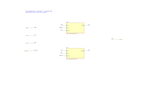
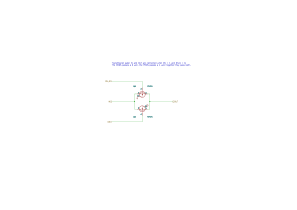
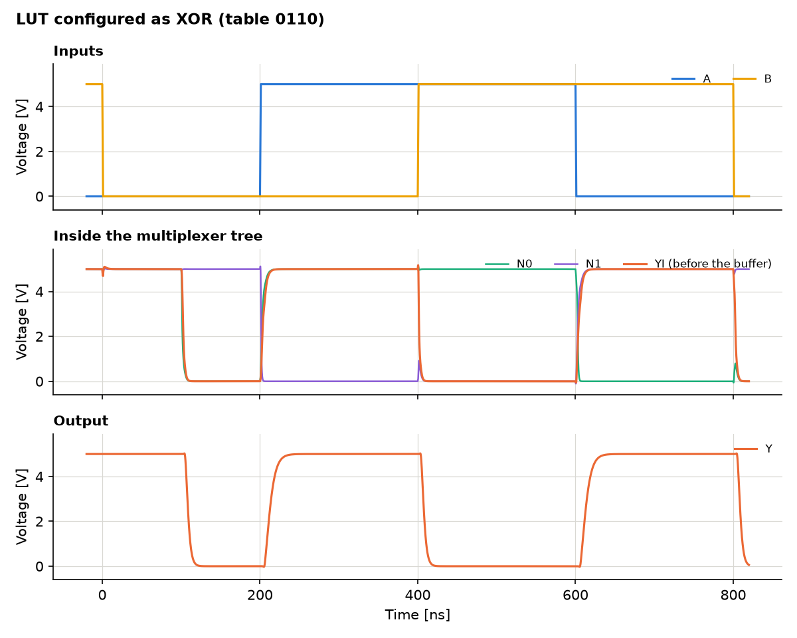
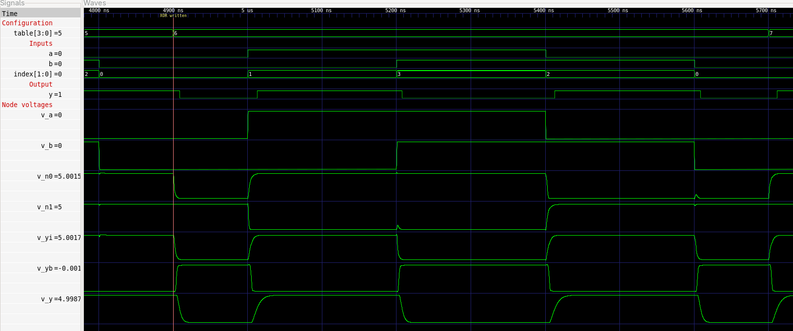

# A look-up table built from transistors

A LUT with two inputs, the logic element of an FPGA, built from 20 MOS
transistors. The circuit is described in Python with
[SKiDL](https://devbisme.github.io/skidl/), drawn as a KiCad schematic,
simulated with ngspice, and the result is written as a VCD file that opens
in [GTKWave](https://gtkwave.sourceforge.net/).

```
SKiDL (lut.py)  ->  KiCad schematic  ->  ngspice  ->  VCD  ->  GTKWave
```

To run it yourself, see [Running the simulation](#running-the-simulation).

## What a LUT is

A LUT with k inputs does not compute anything. It stores the truth table of
a logic function in 2^k memory bits, and its inputs select which of these
bits appears at the output. With two inputs there are four bits and
therefore 16 possible functions, from AND to XOR, all realised by the same
hardware. Only the stored bits differ. That is what makes an FPGA
programmable.

```
T0 --[A=0]--+
            +-- N0 --[B=0]--+
T1 --[A=1]--+               +-- YI --|>o--|>o-- Y
T2 --[A=0]--+               |
            +-- N1 --[B=1]--+
T3 --[A=1]--+
```

The selection is a tree of 2:1 multiplexers, one level per input. The table
index is `2 B + A`. A buffer of two inverters restores the level and drives
the load.

## Configuration by voltage sources

The four table bits T0 to T3 are the configuration of the LUT. Here they
are voltage sources: 0 V for a 0, 5 V for a 1. In an FPGA they are memory
cells written by the bitstream. Replacing the cells by sources keeps the
circuit small and makes the configuration visible in the schematic: the
function of the LUT is the pattern of the four source values. The
simulation rewrites these sources every 800 ns and so steps through all 16
functions in one run.

## The switches

Each switch of the multiplexers is a transmission gate: an NMOS and a PMOS
in parallel, driven by complementary select signals. An NMOS alone passes
a 0 well but hands over a 1 only up to its gate voltage minus its
threshold; a PMOS alone has the opposite problem. Together they pass both
levels without loss, and the internal node YI reaches the full supply.
The price is one extra transistor per switch and the complements AN and BN
of the inputs, made by two inverters.

| Part | Transistors |
|---|---|
| 6 switches, 2 transistors each | 12 |
| 2 inverters for AN and BN | 4 |
| output buffer, 2 inverters | 4 |
| total | 20 |

## A hierarchical schematic

The schematic is hierarchical. Every building block is drawn once, on a
sheet of its own, and used as often as needed.

| Sheet | File | Content | Used |
|---|---|---|---|
| `lut2` | `lut2.kicad_sch` | sources, load, and the sheets below | 1 |
| `inverter` | `inverter.kicad_sch` | one PMOS, one NMOS | 4 |
| `mux2` | `mux2.kicad_sch` | two switches | 3 |
| `switch` | `switch.kicad_sch` | one transmission gate | 6 |
| `buffer` | `buffer.kicad_sch` | two inverters | 1 |

Five files describe 15 sheets. The hierarchy is three levels deep: the
transistors of a switch sit in `lut2 / mux_n0 / sw0`.


The root sheet shows the structure of the LUT: the supply, the inputs, the
four configuration sources, two inverters for the complements of the
inputs, two multiplexers selected by A, one selected by B, and the buffer.





In KiCad a sheet that is used several times stores the references of its
symbols once per use. The transistors of `switch.kicad_sch` are Q5 and Q6
in `mux_n0 / sw0` and Q15 and Q16 in `mux_y / sw1`. `hier.py` takes care
of this: it walks the hierarchy, creates the flat SKiDL circuit and writes
every sheet with the references of all its uses.

## Results

The LUT computes all 16 functions correctly: 64 of 64 table entries. All
numbers below are written by `simulate.py` to `results/summary.md`.

| Quantity | Value |
|---|---|
| Level of the internal node YI for a 1 | 5.00 V |
| Level of the output Y for a 1 | 5.00 V |
| Supply current at rest, largest | 0.015 µA |
| Delay A to Y, rising / falling | 12.2 ns / 9.1 ns |
| Delay B to Y, rising / falling | 10.8 ns / 7.8 ns |
| Delay table bit to Y, rising / falling | 11.1 ns / 8.2 ns |

What the numbers show:

- **The transmission gates pass the full level.** The internal node YI
  reaches 5 V for a 1 and 0 V for a 0, so the first inverter of the buffer
  is fully switched and the circuit draws almost no current at rest.
- **The input of the last level is the fastest.** A signal at B passes one
  multiplexer, a signal at A passes two. B is faster by about 1.4 ns.
  Synthesis tools use this and route timing-critical signals to the fast
  inputs of a LUT.
- **A change of configuration is as fast as a change of input.** A table
  bit passes two multiplexers, like A, and arrives at Y after a similar
  delay.



The plot shows one function window of 800 ns. During the first 100 ns the
table still holds the previous function; it is rewritten at 100 ns.

### Glitches

If both inputs change at the same instant, the multiplexer tree passes
through an intermediate state, even if the old and the new table entry are
the same. `simulate.py` tests this in a second run.

| Change | Lowest level of YI | Lowest level of Y |
|---|---|---|
| XOR, index 1 to 2 | 3.37 V | 5.00 V |
| XOR, index 2 to 1 | 3.58 V | 5.00 V |
| XNOR, index 0 to 3 | 3.14 V | 5.00 V |
| XNOR, index 3 to 0 | 3.74 V | 5.00 V |

The internal node dips, but the dip is too short for the buffer to follow.
With these transistors and this load no glitch reaches the output. That is
a property of this circuit, not of LUTs in general.

## Viewing the waveforms in GTKWave

```sh
gtkwave results/lut2.vcd results/lut2.gtkw
gtkwave results/lut2_glitch.vcd results/lut2_glitch.gtkw
```



The view shows the window from 4.8 µs to 5.6 µs: the table changes from
5 (NOT A) to 6 (XOR) at the marker, then the index steps through 0, 1, 3,
2, and `y` follows the table entry. The analog traces below show the
multiplexer nodes N0 and N1, the tree output YI, and the two stages of
the buffer.

The `.gtkw` file sets up the view: the table as a hexadecimal number, the
inputs, the selected index and the output as logic signals, and below them
the node voltages as analog traces.

| Signal | Kind | Content |
|---|---|---|
| `table[3:0]` | bit vector | the stored function, T3 T2 T1 T0 |
| `a`, `b`, `y` | bit | logic value, threshold at half the supply |
| `index[1:0]` | bit vector | `2 B + A`, the selected table entry |
| `v_a`, `v_b` | real | input voltages |
| `v_n0`, `v_n1` | real | outputs of the first multiplexer level |
| `v_yi` | real | output of the tree, before the buffer |
| `v_yb`, `v_y` | real | after the first and the second inverter |

VCD is a format for digital signals, but it also knows real numbers, and
GTKWave draws them as curves (Data Format, Analog). `vcd.py` is a writer of
about 100 lines without dependencies.

## The simulation

One transient run of 12.8 µs covers all 16 functions.

- The inputs step through the four combinations in Gray code, index
  0, 1, 3, 2, in steps of 200 ns. Only one input changes at a time, so
  every edge of the output can be attributed to one input.
- Every 800 ns the table bits are rewritten, 100 ns after the inputs have
  returned to 00. This is the simulation's version of loading a new
  bitstream.
- The output is sampled 5 ns before the end of every step and compared with
  the table.

The netlist that is simulated is exported from the KiCad schematic with
`kicad-cli`, which flattens the hierarchy, so the schematic is what gets
simulated.

## The paper

`paper/transistor_lut_en.tex` is a step-by-step introduction built on
this circuit: from Boolean functions and Shannon's expansion over the
transistor as a switch, the transmission gate and the CMOS inverter to
the complete LUT and its simulation, with every number in the text
computed from the model or taken from `results/summary.md`. A GitHub
Actions workflow builds the PDF on every push and attaches it to
releases on version tags.

```sh
uv run scripts/make_figures.py       # figures from the model and results/
scripts/make_schematics.sh           # schematic sheets from docs/sheets/
cd paper && latexmk -pdf transistor_lut_en.tex
```

The figures are committed, so a LaTeX installation is enough to build
the PDF; the two scripts are needed only after a change of the circuit
or the simulation.

## Files

| File | Content |
|---|---|
| `lut.py` | the design: sheets `inverter`, `switch`, `mux2`, `buffer` and the root `lut2` |
| `hier.py` | hierarchy: elaborates the sheets into a flat SKiDL circuit and writes the KiCad sheets |
| `generate.py` | writes netlist and schematic, verifies the schematic against the SKiDL circuit |
| `simulate.py` | simulation, analysis, VCD and GTKWave files, plot |
| `vcd.py` | VCD writer |
| `kicad_sch.py`, `ngspice.py` | schematic writer and ngspice wrapper, from [naive-diff-amp-comperator](https://github.com/MaxClerkwell/naive-diff-amp-comperator) |
| `schematic/` | generated KiCad project: root sheet `lut2.kicad_sch`, four sub-sheets, netlist `lut2.net` |
| `docs/` | renderings: one SVG per sheet in `sheets/`, all sheets in `lut2.pdf` |
| `results/` | VCD and GTKWave files, plot, netlist, `summary.md` |
| `paper/` | the paper, `transistor_lut_en.tex`, and its figures |
| `scripts/` | `make_figures.py` and `make_schematics.sh`, the figure generators of the paper |

## Running the simulation

Requirements: [uv](https://docs.astral.sh/uv/), Python 3.10 or newer,
KiCad 9 or 10 with `kicad-cli` and the symbol libraries in
`/usr/share/kicad/symbols`, `libngspice.so.0`, and GTKWave for viewing.
`uv` installs the Python packages (SKiDL, NumPy, Matplotlib) on the first
run.

1. **Generate the schematic.** SKiDL builds the circuit from `lut.py`,
   `hier.py` writes the five KiCad sheets into `schematic/`, and
   `kicad-cli` renders them into `docs/`.

   ```sh
   uv run generate.py
   ```

   The last line must read `schematic <-> SKiDL netlist: IDENTICAL`. It
   means the schematic that KiCad reads describes the same circuit as the
   Python code. The step overwrites the schematic, including manual
   changes made in KiCad. KiCad's electrical rules check reports no
   violations.

2. **Simulate.** `kicad-cli` exports a flat SPICE netlist from the
   schematic, ngspice runs the transient analysis, and the script
   evaluates it.

   ```sh
   uv run simulate.py
   ```

   It takes a few seconds. The console ends with the truth table of all
   16 functions and the measured delays; the same text goes to
   `results/summary.md`. Along with it the script writes `results/lut2.vcd`
   and `results/lut2.gtkw`, the glitch run as `results/lut2_glitch.*`, the
   simulated netlist `results/lut2.cir` and the plot `results/lut2.png`.

3. **Open the result in GTKWave.** Give GTKWave the VCD file and the save
   file; the save file sets up the signal list and the analog traces.

   ```sh
   gtkwave results/lut2.vcd results/lut2.gtkw
   ```

   The view opens on the whole run of 12.8 µs. Zoom with `Ctrl` and the
   mouse wheel, or type a range into the `From` and `To` fields, for
   example `4800ns` and `5600ns` for the XOR window shown above. The
   signals are listed in [Viewing the waveforms in GTKWave](#viewing-the-waveforms-in-gtkwave).
   For the glitch experiment:

   ```sh
   gtkwave results/lut2_glitch.vcd results/lut2_glitch.gtkw
   ```

To look at the schematic, open the root sheet with
`eeschema schematic/lut2.kicad_sch`. A double click on a sheet symbol
enters the sheet.

## Limits

- **The transistor models are generic.** They are level-1 MOS models with
  plausible numbers: threshold 1 V, channel 10 µm by 10 µm, junction
  capacitance 0.5 pF. They describe neither a particular discrete part nor
  an FPGA process. The delays are properties of these models. A LUT in a
  modern FPGA switches in tens of picoseconds.
- **The configuration is ideal.** Voltage sources have no output
  resistance and are never disturbed by the circuit they drive. Memory
  cells in an FPGA are, and have to be dimensioned for it.
- **No layout.** Wiring capacitance and resistance are not part of the
  simulation. There is a single load of 10 pF at the output.
- **Four-terminal transistors.** The bulk of every NMOS is tied to ground
  and of every PMOS to the supply, as on a chip. Discrete MOSFETs with
  three terminals have bulk and source connected inside the package, and
  their body diode conducts in a transmission gate. For a build on a
  breadboard use an array with a separate bulk terminal, such as the
  CD4007.
